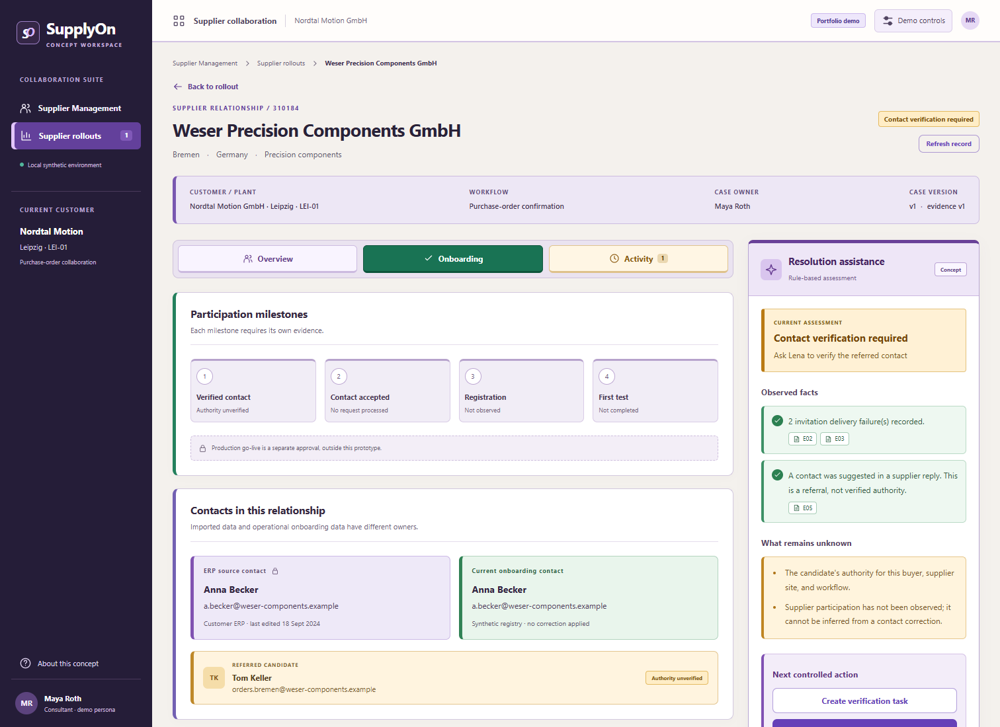
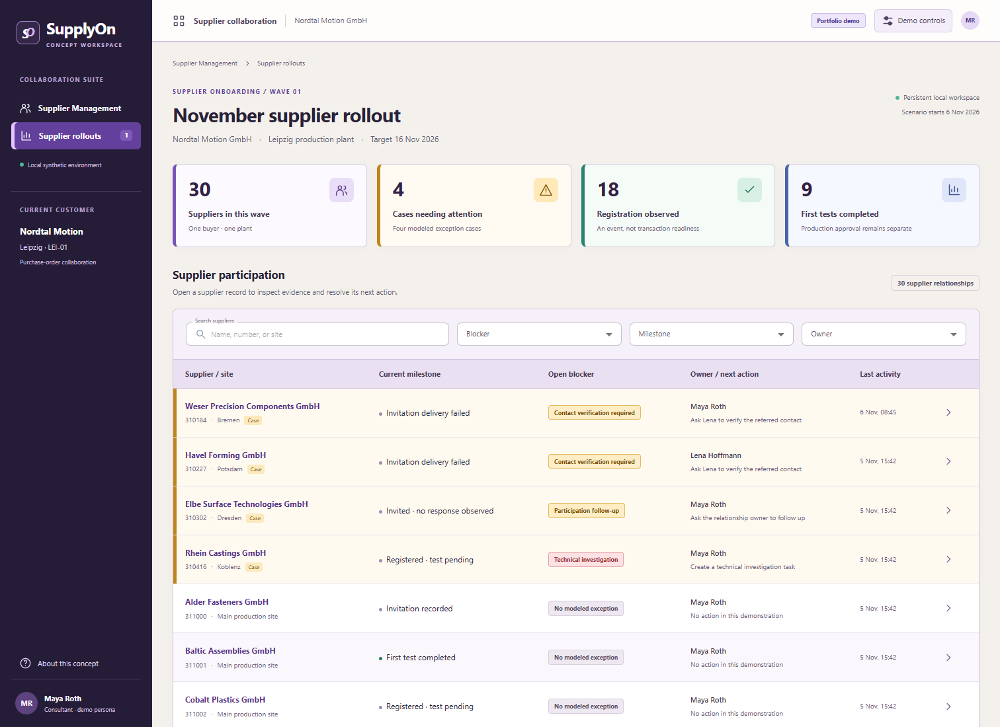
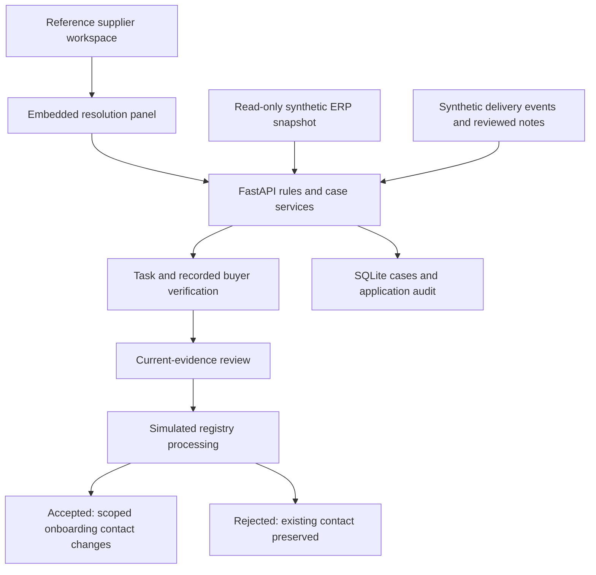

# Supplier Onboarding Resolution

A working supplier onboarding feature that turns conflicting contact records and delivery failures into verified, reviewed actions. It is embedded in a supplier collaboration workspace, with the supplier record, source evidence, and next task visible together.

Built by **Mann D. Shah** through AI-assisted development, covering product definition, process design, domain rules, and acceptance testing.

**Independent portfolio concept · Synthetic data · Hosted demo and local operation · MIT license**

[Open the live demo](https://supplier-onboarding-resolution.vercel.app)

The frontend runs on Vercel and forwards `/api/*` to a Cloudflare Python Worker. A SQLite-backed Durable Object stores each browser's synthetic workspace separately. Reloading retains that browser's changes; Demo reset restores only its own scenario. The anonymous browser identifier is not authentication. Use fictional data only.

To deploy backend changes with an authenticated Cloudflare CLI, run `uv run pywrangler deploy`. `pyproject.toml` and the lockfiles manage Worker dependencies; `requirements-local.txt` retains the local Uvicorn setup. The build stages only backend source into ignored `.wrangler/backend/`. Vercel deploys frontend changes from `main`, using the proxy and deep-link rewrites in `vercel.json`.

To verify a deployed demo, install `requirements-dev.txt` and run `python tests/hosted_smoke.py https://supplier-onboarding-resolution.vercel.app`. This uses isolated synthetic sessions and checks accepted/rejected processing, stale reviews, validation, persistence, and visitor isolation.



> This project is inspired by publicly described supplier onboarding challenges. It is not SupplyOn software, an official extension, or an endorsed product. The reference workspace and every business record are fictional. There is no live ERP, SupplyOn, email, or AI-model connection.

## The problem

A supplier appears as “invited,” but two invitations never reached its mailbox. A newer spreadsheet points to the wrong site. A reply suggests another person, whose authority is unknown.

The next useful action is not another automatic reminder. The buyer needs to verify the right operational contact, and the consultant needs to review a narrowly scoped correction.

This prototype follows that case all the way through a simulated receiving-system response, including rejection. It also shows when a similar-looking delay needs a different intervention.

## What works

- **Embedded workflow:** rollout list → supplier record → resolution panel, without opening a separate tool.
- **Evidence inspection:** every assessment fact links to its source event or reviewed synthetic annotation.
- **Human decisions:** create tasks, record confirmed or inconclusive verification, and review a contact correction.
- **Ownership boundaries:** the imported ERP contact stays unchanged; only a separate synthetic onboarding-contact registry can update.
- **Failure handling:** new evidence invalidates old reviews, stale browser writes are blocked, and rejected updates preserve the existing contact.
- **Persistence:** SQLite retains tasks, attestations, requests, and application history across reloads.
- **Separate milestones:** contact acceptance, registration, and the first transaction test each require their own recorded event.
- **Readable interface:** distinct tabs, colored card borders, boxed evidence, and desktop/mobile layouts.



## Four cases to explore

| Supplier | What the evidence shows | Appropriate intervention |
|---|---|---|
| **Weser Precision Components** | Invitations bounced; another site referred a candidate | Verify authority, review the correction, then process an accepted or rejected simulated update |
| **Havel Forming** | A candidate exists, but the supplied verification remains inconclusive | Keep the case blocked and request clarification |
| **Elbe Surface Technologies** | Delivery was accepted, but no participation event is recorded | Follow up; do not infer an invalid contact or refusal |
| **Rhein Castings** | Registration exists, but a transaction test failed | Assign a technical investigation rather than contact repair |

The rollout contains **30 synthetic supplier relationships**: these four substantive case types and 26 reference records. The additional rows provide context; they do not imply 30 independently modeled workflows.

## Quick start

Use **Python 3.13** and **Node.js 24** for the verified environment. Start in your local clone of this repository. No keys, cloud accounts, or Docker are required.

### Windows / PowerShell

```powershell
python -m venv .venv
.\.venv\Scripts\python.exe -m pip install -r requirements-local.txt
npm.cmd ci
npm.cmd run build
.\.venv\Scripts\python.exe -m app
```

### macOS / Linux

```bash
python3 -m venv .venv
.venv/bin/python -m pip install -r requirements-local.txt
npm ci
npm run build
.venv/bin/python -m app
```

Open **http://127.0.0.1:8765** manually. Keep the foreground server running while using the app; stop it with **Ctrl+C**.

The frontend must be built after cloning because `dist/` is not committed. If the page is unreachable, check that the server is still running. This is a full-stack application: **GitHub Pages alone cannot run the backend**.

Data is created automatically at `data/prototype.sqlite3`. Use **Demo controls → Reset synthetic rollout** to restore the examples. Reset affects only the prototype database.

### Configuration

| Variable | Default | Purpose |
|---|---|---|
| `PORT` | `8765` | Loopback HTTP port |
| `ONBOARDING_DB` | `data/prototype.sqlite3` | SQLite database location |

For an occupied port, set `$env:PORT = '8766'` in PowerShell or `export PORT=8766` in a POSIX shell before starting. The server intentionally binds to `127.0.0.1`.

For frontend development, run the backend and `npm run dev` in two foreground terminal sessions. The Vite development proxy expects the backend on port 8765. Stop both when finished.

## Demonstrate the feature

1. Open **Weser**, inspect the failed deliveries and wrong-site referral, and create a verification task.
2. Record the provided **synthetic verification example** on Lena’s behalf. The form is a recorded attestation, not an identity check performed by the app.
3. Propose the correction, inspect its scope, and review it as Maya.
4. Add evidence using Demo controls to see approval become stale. Review again before processing.
5. Process the simulated update. Tom becomes the onboarding contact only after an accepted response; Anna stays in the ERP snapshot.
6. Record registration and first test confirmation as separate events. Production approval remains outside the prototype.

For the rejection path, select **Rejected · scope locked** in Demo controls, reset the synthetic rollout, and replay Weser. The approved request is rejected and the existing contact remains current.

See the [full demo guide](docs/DEMO.md) for the case sequence, expected outcomes, and interview framing.

## Architecture



| Layer | Implementation |
|---|---|
| Interface | React, TypeScript, Material UI, Vite |
| Application | FastAPI, Pydantic, explicit business rules |
| Storage | SQLite transactions using Python's standard library |
| Assessment | Deterministic `SummaryProvider`; no live LLM |
| Verification | pytest acceptance tests and a real-browser Playwright walkthrough |

The host shell and proposed feature are represented separately in the interface. Real deployment would require validated host interfaces, data ownership, identity, and authorization design.

[Architecture and local API](docs/ARCHITECTURE.md) · [Contribution guide](CONTRIBUTING.md) · [Security and data boundaries](SECURITY.md)

## Tests and continuous integration

Install development dependencies in the virtual environment:

```powershell
.\.venv\Scripts\python.exe -m pip install -r requirements-dev.txt
npm.cmd run build
.\.venv\Scripts\python.exe -m pytest -q tests/test_workflow.py
.\.venv\Scripts\python.exe -m playwright install chromium
.\.venv\Scripts\python.exe tests/browser_smoke.py
```

On macOS/Linux, use `.venv/bin/python` and `npm` in the same sequence. Linux may need `python -m playwright install --with-deps chromium` to install the browser's system dependencies.

The browser script starts its own temporary server and isolated database, then closes its server and browser even if a check fails. It does not modify the normal application database. Inspection images go to ignored `test-results/`.

**Verified locally:** production build, 17 backend tests, and the browser walkthrough passed. Desktop/mobile screenshots were inspected. The walkthrough reported no JavaScript errors or external browser requests. Windows was the local verification platform; see [GitHub Actions](https://github.com/mann13072/supplier-onboarding-resolution/actions) for the latest hosted Ubuntu result.

[GitHub Actions](.github/workflows/ci.yml) installs dependencies, builds the frontend, runs backend tests, and runs the browser walkthrough on pushes and pull requests. It does not publish or deploy the application.

## Limits that matter

- Synthetic contact verification is a recorded human attestation, not an automated identity check.
- Persona labels are not authentication; this is a single-user local prototype.
- The audit is append-only through application operations, not a tamper-proof production ledger.
- Mail annotations are reviewed fixtures, not automatic extraction from arbitrary emails.
- A test confirmation is not proof of a production transaction or approval to go live.
- No customer savings, production readiness, official API compatibility, or gap in SupplyOn's internal tools is claimed.

## Background and sources

SupplyOn publicly describes supplier engagement, contact-data quality, communication, and enablement as onboarding concerns. It also already offers onboarding visibility and supplier-data management. These sources establish the problem area's relevance, not missing functionality.

- [Successful supplier onboarding](https://www.supplyon.com/en/resources/successful-supplier-onboarding/) — public landing page; gated factsheet not accessed.
- [“Success as a Service”: Supplier Onboarding at SupplyOn](https://www.supplyon.com/en/blog/success-as-a-service-supplier-onboarding-at-supplyon/) — contact quality, participation, and human support.
- [Seven success factors of supplier onboarding](https://www.supplyon.com/en/blog/success-factors-for-supplier-onboarding/) — historical description of activity records, dashboards, and usage reporting.
- [Supplier Master Data & Information](https://www.supplyon.com/en/solutions/supplier-management/supplier-information-management/) — existing data-management capabilities.

## License and attribution

Project source, original documentation, and synthetic demo screenshots are released under the [MIT License](LICENSE). Copyright © 2026 Mann D. Shah.

Third-party dependencies retain their own licenses. SupplyOn and other product names remain the property of their respective owners; this project grants no trademark rights and claims no affiliation or endorsement.
