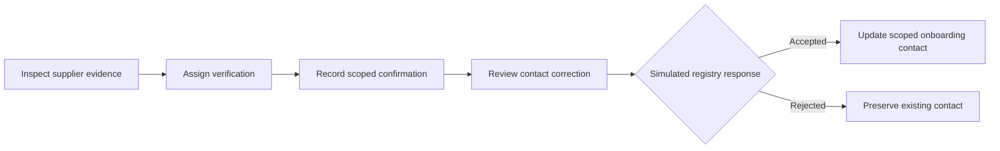

# Supplier Onboarding Resolution

**Evidence-based exception handling inside a supplier collaboration workspace.**

Supplier Onboarding Resolution helps a buyer investigate bounced invitations, conflicting contact records and unclear authority. It connects source evidence to a verification task, a reviewed contact correction and an explicit receiving-system outcome, while preserving the original ERP snapshot.

[Live demo](https://supplier-onboarding-resolution.vercel.app/) · [Demo guide](docs/DEMO.md) · [Architecture and API](docs/ARCHITECTURE.md)

Independent working prototype with **30 synthetic supplier relationships**, including four substantive exception cases. The application runs locally and as a hosted demo.


## The resolution workflow



1. **Investigate.** Review the imported contact, delivery results and supplier correspondence in the same record.
2. **Verify.** Ask the relationship owner to confirm the candidate's authority for the buyer, supplier site and workflow.
3. **Review.** Compare the proposed correction with the current contact and the latest evidence.
4. **Process.** Apply the simulated registry response. Approval alone does not change the operational contact.
5. **Track participation.** Record registration and the first transaction test as separate milestones.

## Core capabilities

### Evidence-linked decisions

The assessment cites source events, states what remains unknown and proposes a next action appropriate to the blocker. Original synthetic correspondence and reviewed annotations remain visible alongside the recommendation.

The implementation uses deterministic business rules. A bounced invitation calls for contact verification; an unanswered invitation calls for participation follow-up; a failed transaction test calls for technical investigation.

### Scoped changes and data ownership

Contact corrections apply to a specific buyer, supplier number, site and workflow. The imported ERP contact remains read-only. Only the separate synthetic onboarding-contact registry changes after an approved request receives an accepted response.

Verification records capture the candidate, scope, method and outcome. An inconclusive verification keeps the correction blocked.

### Review and consistency controls

- **Current evidence:** new evidence invalidates earlier reviews and requires renewed approval.
- **Version checks:** stale browser writes return a conflict instead of overwriting newer work.
- **Explicit outcomes:** rejected requests preserve the current contact and expose the receiving-system reason.
- **Idempotent processing:** repeat processing returns the recorded outcome without duplicating the update.
- **Transactional history:** business changes and audit entries commit together in SQLite.

### Participation visibility

The rollout view keeps contact resolution, registration and transaction testing separate. Filters and supplier records help users identify the next intervention without treating a contact correction as completed onboarding.


## Four cases to explore

| Supplier | Observed problem | Workflow |
|---|---|---|
| **Weser Precision Components** | Bounced invitations and a wrong-site referral | Verify the candidate, review a scoped correction and process acceptance or rejection |
| **Havel Forming** | Candidate authority remains inconclusive | Retain the current contact and request clarification |
| **Elbe Surface Technologies** | Invitation delivered, participation unobserved | Assign a relationship-owner follow-up |
| **Rhein Castings** | Registration completed, transaction test failed | Assign a technical investigation |

The remaining 26 relationships provide rollout context. The [demo guide](docs/DEMO.md) walks through the full Weser case, stale-review handling and the rejection path.

## Architecture

| Layer | Implementation | Responsibility |
|---|---|---|
| Interface | React, TypeScript, Material UI, Vite | Rollout, supplier record, evidence panel and task/review flows |
| Application | FastAPI, Pydantic | Request validation and explicit workflow rules |
| Assessment | `RuleBasedSummary` behind `SummaryProvider` | Evidence-linked facts, unknowns and permitted next actions |
| Local storage | SQLite | Case state, scoped contact registry and audit entries |
| Hosted demo | Vercel and Cloudflare Python Worker | Same-origin API forwarding and SQLite-backed Durable Objects |
| Acceptance checks | pytest and Playwright | Business-rule checks and browser walkthroughs |

The local FastAPI process serves both the built frontend and the API. The hosted version stores each browser's synthetic workspace separately; its anonymous browser identifier provides workspace separation, not user authentication.

[Detailed architecture](docs/ARCHITECTURE.md) · [Security and data boundaries](SECURITY.md) · [Contribution guide](CONTRIBUTING.md)

## Quick start

Use **Python 3.13** and **Node.js 24**, matching the documented development and CI environment. The local demo needs no API keys, cloud account or Docker installation.

Run from the repository root.

**Windows / PowerShell**

```powershell
python -m venv .venv
.\.venv\Scripts\python.exe -m pip install -r requirements-local.txt
npm.cmd ci
npm.cmd run build
.\.venv\Scripts\python.exe -m app
```

**macOS / Linux**

```sh
python3 -m venv .venv
.venv/bin/python -m pip install -r requirements-local.txt
npm ci
npm run build
.venv/bin/python -m app
```

Open **http://127.0.0.1:8765** and the API documentation at **http://127.0.0.1:8765/api/docs**. Keep the command running while using the demo; stop it with `Ctrl+C`.

The build step creates the frontend assets. SQLite initialises the fixtures at `data/prototype.sqlite3`; **Demo controls → Reset synthetic rollout** restores the selected accepted/rejected scenario.

| Setting | Default | Purpose |
|---|---|---|
| `PORT` | `8765` | Local HTTP port |
| `ONBOARDING_DB` | `data/prototype.sqlite3` | SQLite path; override for isolated runs |

## Validation

Install the development dependencies before running the acceptance checks:

```powershell
.\.venv\Scripts\python.exe -m pip install -r requirements-dev.txt
npm.cmd run build
.\.venv\Scripts\python.exe -m pytest -q tests/test_workflow.py
.\.venv\Scripts\python.exe -m playwright install chromium
.\.venv\Scripts\python.exe tests/browser_smoke.py
```

On macOS/Linux, use `.venv/bin/python` and `npm`. Linux browser checks may require `python -m playwright install --with-deps chromium`.

The backend suite covers verification scope, stale reviews, rejected updates, repeated processing and independent participation milestones. The browser walkthrough exercises the workflow with an isolated temporary database and closes its temporary server when finished.

[GitHub Actions](https://github.com/mann13072/supplier-onboarding-resolution/actions) runs the build, backend tests and browser walkthrough on pushes to `main` and pull requests.

## Prototype scope

All organisations, people, events and integration results are synthetic. Verification records represent human attestations, and persona labels illustrate responsibilities rather than authenticated identities. The application uses deterministic assessments and has no live ERP, SupplyOn, email or AI-model integration.

The project demonstrates process design and controlled collaboration. It is independent of SupplyOn, with no affiliation or endorsement; production authorisation and enterprise integration remain outside its scope.

## Author and licence

Created by [Mann D. Shah](https://github.com/mann13072) through AI-assisted development, covering product definition, process modelling, domain rules and acceptance testing.

Licensed under the [MIT License](LICENSE). Third-party dependencies and trademarks remain subject to their respective terms.
