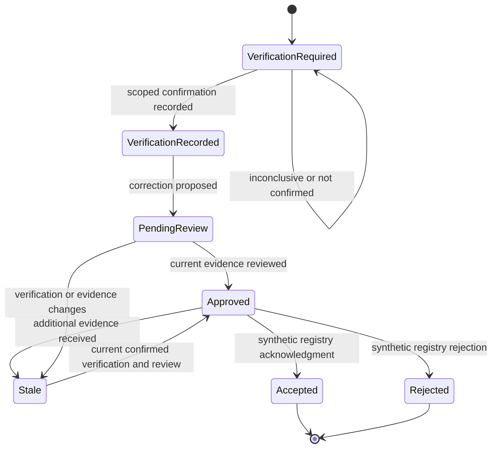

# Architecture and API

## Application boundary

The application has one browser origin and one local backend. Vite builds React and TypeScript into `dist/`. FastAPI serves those static assets, the application routes, and the `/api/` endpoints. The normal runtime does not need a Node process.

The reference workspace supplies navigation, rollout context, supplier records, and an activity timeline. Resolution assistance is a contextual panel within the supplier record. This represents an embedding approach; it is not installed in any real enterprise host.

## Source ownership

| Record | Represented owner | Allowed behavior |
|---|---|---|
| Buyer supplier number, plant, imported contact | Customer ERP/SRM export | Read-only snapshot |
| Invitation and participation events | Onboarding platform | Explicit synthetic fixture events |
| Bounce result | Mail-delivery service | Evidence, not a conclusion about intent |
| Supplier reply | Case process | Original synthetic text plus reviewed fixture annotations |
| Candidate verification | Buyer relationship owner | Recorded attestation with method, scope, outcome, and note |
| Current onboarding contact | Synthetic relationship-contact registry | Changes only after an accepted approved request |
| Production activation | Actual operational process | Outside scope |

The registry key is:

```text
buyer ID | buyer supplier number | supplier site ID | workflow
```

A buyer supplier number is not a universal company identifier. Matching email domains do not establish authority. A newer source record is not automatically more reliable.

## Main objects

- **Case:** supplier relationship, source snapshot, evidence, tasks, verifications, requests, independent milestone flags, case version, and evidence version.
- **Task:** intervention type, owner, instructions, due date, source references, and status.
- **Verification:** candidate, exact scope, method, outcome, note, recorded verifier, and evidence ID.
- **Change request:** previous contact, proposed contact, verified scope, review snapshot, status, and receiving-system result.
- **Registry contact:** operational onboarding contact for one scoped relationship.
- **Audit entry:** actual recording time, actor label, action, and details.

SQLite stores case payloads, scoped registry values, audit entries, and the demo scenario setting. Source snapshots are preserved by the application service during mutations.

## Controlled correction flow



An accepted correction resolves the contact blocker; it does not establish participation. Registration and first-test completion are separately recorded events. Production activation remains outside the state machine.

An inconclusive result is a legitimate outcome. A delivered-but-unanswered invitation routes to participation follow-up. A registered supplier's failed test routes to a technical task. Those cases do not expose contact-replacement actions.

## Consistency and failure handling

- Each browser mutation submits the current `expectedVersion`. A mismatch returns HTTP 409 rather than overwriting newer work.
- Evidence has its own version. Approval records the reviewed evidence version; new evidence makes the request stale.
- Buyer, site, workflow, candidate, and recorded verification must match the request.
- Business changes and their audit entry commit in the same SQLite transaction.
- Processing an already accepted or rejected request returns its existing outcome. It does not repeat the contact update or audit action.
- A rejected update preserves the current registry contact and all ERP source fields. There is no automatic retry or second-request flow in v1; reset the synthetic scenario to replay it.
- Duplicate open tasks of the same intervention type return a conflict.
- A missing API route returns JSON 404, not the frontend HTML. An unbuilt frontend returns a 503 explaining the build step.

The local database and audit are not tamper-proof, and actor labels are not authentication. See [SECURITY.md](../SECURITY.md).

## Assessment and the future AI boundary

`SummaryProvider` defines an assessment interface. `RuleBasedSummary` is its only implementation. It produces factual statements with evidence IDs, explicit unknowns, and permitted next actions.

The original email text is visible. Structured referral information comes from reviewed synthetic annotations; the application does not parse arbitrary mail automatically.

A future model could summarize cited notes or draft tasks. It would need a separate evaluation against the deterministic baseline. It would not establish identity, approve changes, activate contacts, or mark readiness.

## Local HTTP interfaces

Open `/api/docs` while the server runs for the generated request/response documentation.

| Method and path | Purpose |
|---|---|
| `GET /api/health` | Runtime status and explicit integration boundary |
| `GET /api/rollouts/nordtal-november` | Rollout and synthetic supplier records |
| `GET /api/cases/{case_id}` | Complete case view and rule-based assessment |
| `POST /api/cases/{case_id}/tasks` | Create the permitted intervention |
| `POST /api/cases/{case_id}/verifications` | Record a scoped attestation |
| `POST /api/cases/{case_id}/change-requests` | Propose a verified correction |
| `POST /api/change-requests/{request_id}/approve` | Review current evidence |
| `POST /api/change-requests/{request_id}/process-demo` | Apply the selected simulated result |
| `POST /api/demo/cases/{case_id}/events` | Add explicit synthetic evidence or milestones |
| `POST /api/demo/reset` | Restore fixtures and select `accepted` or `rejected` |

### Example: record the main case's fictional verification

First read `/api/cases/weser` and use its current version. The version below illustrates the request shape; do not reuse it after other changes.

```json
{
  "expectedVersion": 1,
  "candidateEmail": "orders.bremen@weser-components.example",
  "scopeKey": "nordtal|310184|BRE|Purchase-order confirmation",
  "outcome": "confirmed",
  "method": "approved_phone",
  "note": "Lena used the existing approved purchasing contact route and confirmed Tom for Nordtal's Bremen order-confirmation workflow."
}
```

Other verification outcomes are `inconclusive` and `not_confirmed`. Allowed methods are `approved_phone` and `existing_account_contact`. The endpoint records the attestation; it does not independently validate its truth.

Ordinary writes require `expectedVersion`; demo reset does not. Pydantic rejects unknown fields and invalid field values. HTTP 409 signals a business conflict, 422 request validation, and 404 an unknown object or route.

## Repository layout

```text
app/                  FastAPI routes, rules, fixtures, SQLite store
src/                  React workspace, typed views, visual theme
tests/                Backend and bounded browser acceptance checks
docs/                 Architecture, demo, publishing notes, approved images
.github/              CI workflow and contribution templates
requirements*.txt     Runtime and development dependencies
package-lock.json     Locked JavaScript dependency resolution
```

`data/`, `dist/`, `node_modules/`, test captures, caches, logs, and environment files are excluded from Git. Documentation images in `docs/assets/` are intentionally included.

## Clocks and environment

The initial fictional snapshot is 6 November 2026. The synthetic registration/test events occur on 9/10 November. The audit records actual local action times. The UI labels those clocks separately.

`PORT` defaults to 8765. `ONBOARDING_DB` overrides the database location for isolated runs. Host binding is loopback-only. Vite development requests proxy `/api/` to the default backend port; the built app uses same-origin requests.
